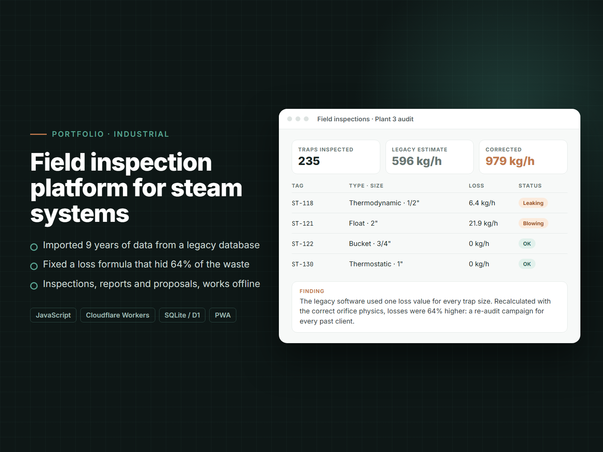
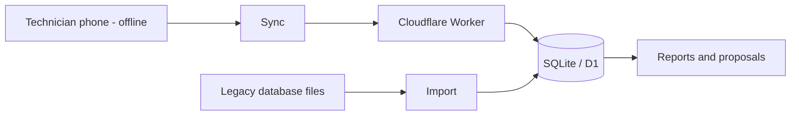

# Field inspection platform for steam systems

> A 17-screen web app for an industrial service company: clients, inspections, reports and proposals, working offline on phones.



## The problem

The company ran its steam trap inspections on a desktop database more than 20 years old, with reports assembled by hand.

## What I built

- Web app (installable on phones, works offline) for clients, inspections, reports and proposals
- 9 years of history imported from the legacy database files
- Loss calculation rebuilt with the correct orifice physics
- Sync across devices, with photos and automatic backups

## How it works



## Results

- While importing, I found the legacy software used one loss value for every trap size
- With the correct physics, losses were **64% higher** than reported
- That finding became a re-audit campaign for all past clients

## Stack

JavaScript (no framework) · Cloudflare Workers · SQLite / D1 · PWA

## A look at the approach

Illustrative example written for this page (not the production code). The orifice size depends on trap type, size and pressure class, which the legacy table ignored.

```js
// Simplified: steam loss through a failed trap orifice (Napier's equation).
// W [kg/h] = 0.41197 * d^2 [mm2] * P_abs [bar] * Cd
function steamLossKgH(orificeMm, pressureBarGauge, cd = 0.6) {
  const pAbs = pressureBarGauge + 1.013;
  return 0.41197 * orificeMm ** 2 * pAbs * cd;
}
```

---

### About this repository

This is a **showcase**: it documents a system I built and run in production for a client. The source code is private
and client data is never shown. The screenshot uses sample data.

Want something like this for your business? [Hire me on Upwork](https://www.upwork.com/freelancers/mateus14).
